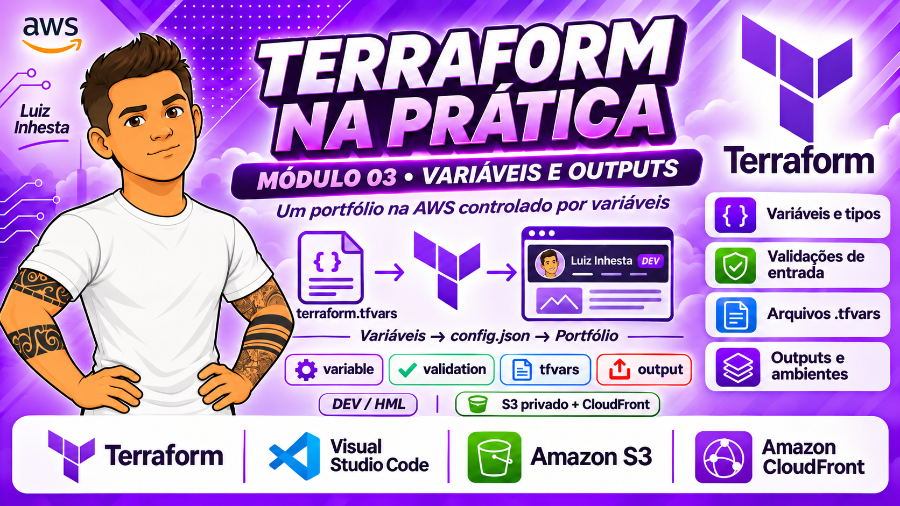
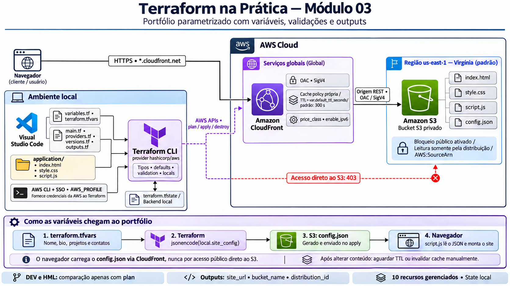

# Módulo 03 - Parametrizando a infraestrutura com variáveis, validações e outputs para alternar entre DEV e HML



## Artigo: um portfólio na AWS controlado por variáveis

> Módulo 03 do curso **Terraform na Prática**. Neste laboratório, eu publiquei um site de portfólio na AWS e mudei o conteúdo dele apenas alterando variáveis do Terraform, sem editar o HTML.

.png)

## Em uma frase

Um site estático (HTML, CSS e JavaScript) fica em um bucket S3 privado e é entregue ao mundo por HTTPS via CloudFront. Nome, bio, projetos, tecnologias e contatos vêm das **variáveis** do Terraform.

## Por que este projeto existe?

Nos módulos anteriores, o Terraform criava a infraestrutura sempre com valores fixos no código. Isso funciona para um teste, mas não para o dia a dia. Neste módulo eu aprendi a **parametrizar** a infraestrutura: o código fica igual e os valores mudam de fora para dentro.

Na prática, isso permite:

- reaproveitar o mesmo código para ambientes diferentes (por exemplo, `dev` e `hml`);
- evitar valores errados com regras de validação;
- trocar o conteúdo do site mudando um arquivo de variáveis;
- consultar informações da infraestrutura criada (URL, ID, ARN) por meio de outputs.

## Arquitetura



O detalhamento está em [docs/ARQUITETURA.md](docs/ARQUITETURA.md).

## Como funciona

```
Navegador --HTTPS--> CloudFront (OAC) --> S3 privado
                                          ├─ index.html, style.css, script.js
                                          └─ config.json  (gerado das variáveis)
```

1. Você preenche as variáveis (por exemplo, no `terraform.tfvars`).
2. O Terraform transforma essas variáveis em um arquivo `config.json`.
3. O `script.js` lê o `config.json` no navegador e monta a página.
4. Mudou uma variável? Muda o `config.json` e, consequentemente, o site.

O bucket S3 não é público. Somente o CloudFront consegue ler os arquivos, usando o OAC (Origin Access Control).

## O que eu aprendi

| Tema | Em linguagem simples |
|---|---|
| `variable` | Um "parâmetro" do código: o valor vem de fora |
| `type` | Define o formato esperado (texto, número, lista, objeto...) |
| `default` | Valor usado quando nada é informado |
| `validation` | Uma regra que barra valores inválidos antes de falar com a AWS |
| `terraform.tfvars` e `-var-file` | Formas de informar os valores |
| `output` | Informações úteis mostradas ao final (URL do site, ID, ARN) |
| `sensitive` | Esconde um valor na tela, mas **não** protege o state |
| `locals` e `merge()` | Cálculos internos, como montar as tags |

Explicações mais detalhadas estão em [CONCEITOS.md](docs/CONCEITOS.md).

## O que foi criado na AWS

São **10 recursos**:

| Recurso | Para que serve |
|---|---|
| Bucket S3 | Guarda os arquivos do site |
| Bloqueio de acesso público | Impede acesso direto ao bucket |
| Política do bucket | Libera leitura apenas para o CloudFront |
| Origin Access Control (OAC) | Identidade que o CloudFront usa para ler o S3 |
| Cache policy | Define por quanto tempo o CloudFront guarda os arquivos (TTL, vindo de variável) |
| Distribuição CloudFront | Entrega o site por HTTPS |
| 3 objetos S3 (HTML, CSS, JS) | Os arquivos do site |
| 1 objeto `config.json` | Gerado pelo Terraform a partir das variáveis |

> Atenção a custos: o CloudFront pode gerar cobrança acima do free tier. Destrua tudo quando terminar.

## Passo a passo resumido

```powershell
cd etapa-01-fundamentos/modulo-03-variables/terraform
$env:AWS_PROFILE = "<seu-perfil>"
Copy-Item terraform.tfvars.example terraform.tfvars
terraform init
terraform validate
terraform plan
terraform apply
terraform output site_url
```

Quando terminar:

```powershell
terraform destroy
```

Detalhes completos em [IMPLANTACAO.md](docs/IMPLANTACAO.md).

## O que aconteceu no laboratório

1. **Preparei as variáveis** e rodei `terraform init`, `validate` e `plan`.
2. **Apliquei** a infraestrutura. A distribuição CloudFront é a parte mais demorada.
3. **Abri o site** pela URL do CloudFront. Ele mostrou os valores padrão ("Seu Nome") e o selo `DEV`.
4. **Confirmei no console da AWS** os arquivos no S3, o bloqueio de acesso público e a origem com OAC.
5. **Mudei as variáveis** (nome, bio e links). O `plan` mostrou só 1 alteração, no `config.json`.
6. **Descobri o cache:** o site continuou com o texto antigo até eu invalidar o cache do CloudFront. Depois disso, o novo conteúdo apareceu.
7. **Comparei dev e hml** apenas com `plan`, sem aplicar.
8. **Testei validações** e **destruí tudo** ao final, com `10 destroyed`.

.png)

## Pontos de atenção

- **Tudo que você colocar nas variáveis do perfil fica público** no site. Não use dados que não queira publicar.
- **Cache do CloudFront:** o Terraform atualiza o S3, mas não limpa o cache. Aguarde o TTL ou invalide uma vez.
- **dev e hml no mesmo state:** o nome do bucket inclui o ambiente, então trocar de ambiente faz o Terraform **substituir** o bucket. Use o arquivo de cada ambiente só para comparar com `plan`.
- **`sensitive` não é cofre:** o valor continua em texto puro no state.
- **Não versione** `terraform.tfvars` nem `terraform.tfstate`.

## Estrutura do módulo

```
modulo-03-variables/
├── application/   # site: index.html, style.css, script.js
├── terraform/     # código do Terraform e arquivos .tfvars de exemplo
├── docs/          # documentação detalhada
├── imagens/       # prints do laboratório
└── README.md
```

## Documentação

| Arquivo | Conteúdo |
|---|---|
| [CONCEITOS](docs/CONCEITOS.md) | Variáveis, tipos, validações, outputs e precedência |
| [IMPLANTACAO](docs/IMPLANTACAO.md) | Passo a passo com prints do laboratório |
| [TESTES](docs/TESTES.md) | Testes para validar o resultado |
| [EXERCICIOS](docs/EXERCICIOS.md) | Exercícios, desafios e respostas |
| [DESTRUICAO](docs/DESTRUICAO.md) | Como remover tudo e evitar custos |

## Pré-requisitos

- Terraform CLI 1.5 ou superior.
- AWS CLI com sessão SSO ativa.
- Entendimento básico do módulo 02 (a arquitetura é a mesma).

## Próximos passos

State e drift (módulo 04), depois workspaces, backends, gestão de segredos e módulos reutilizáveis.
