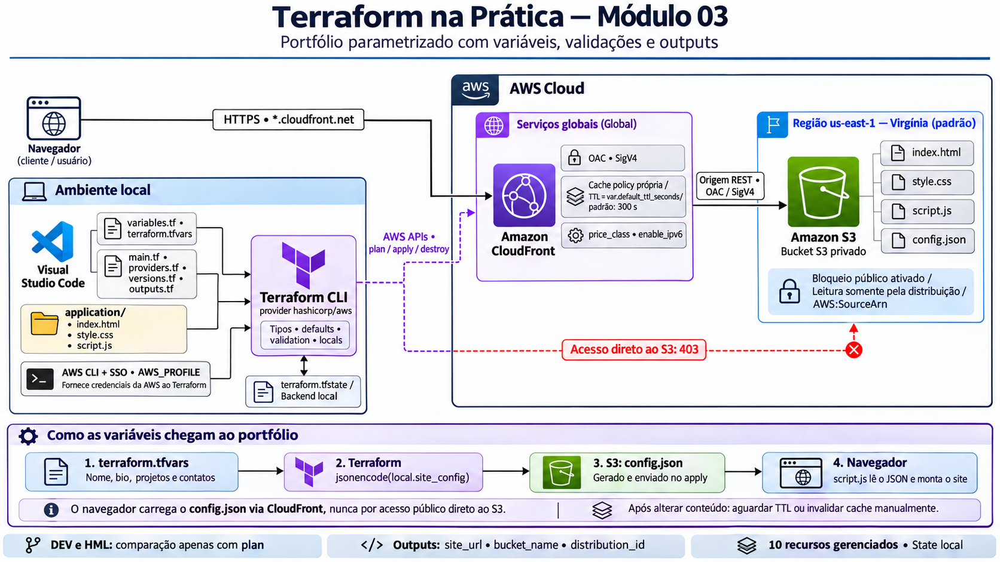
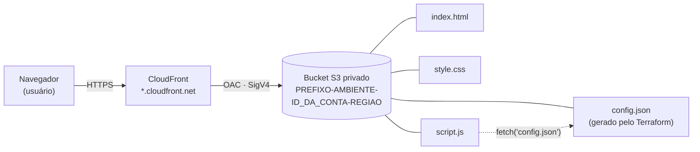
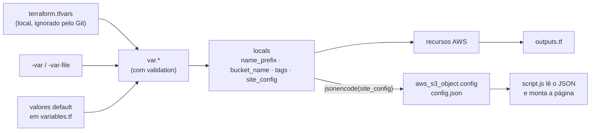
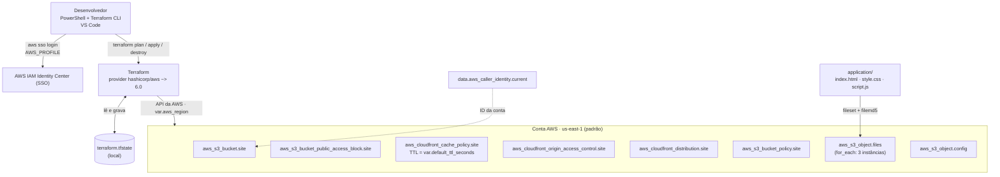
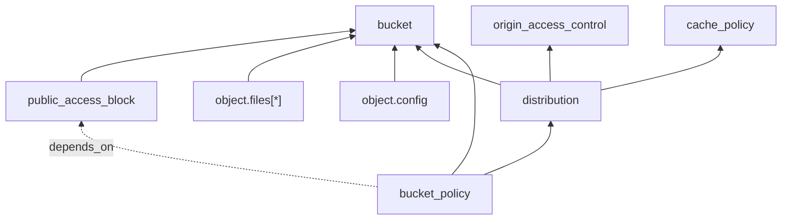
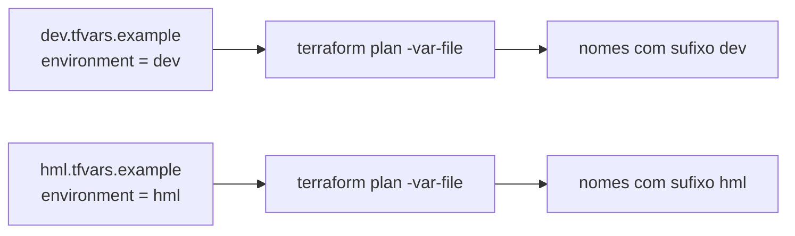
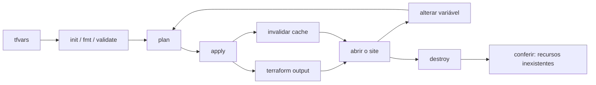

# Arquitetura — Módulo 03

Este documento descreve o que foi construído no laboratório: quais recursos existem na AWS, como as variáveis alimentam a infraestrutura e como o Terraform monta tudo.

> Os diagramas usam Mermaid. No VS Code, abra o preview com `Ctrl+Shift+V` e instale a extensão **Markdown Preview Mermaid Support** (`bierner.markdown-mermaid`) para vê-los renderizados.

## Diagrama da arquitetura

## Visão geral

A infraestrutura de entrega é a mesma do módulo 02: site em bucket S3 **privado**, servido por HTTPS pelo CloudFront com OAC. A novidade é que valores antes fixos viram **variáveis**, e o conteúdo da página vem de um `config.json` **gerado pelo Terraform** a partir delas. Para mudar o texto do portfólio, altera-se uma variável, sem editar o HTML.

## Como as variáveis chegam ao site

Precedência de valores (do menor para o maior): `default` → `terraform.tfvars` → `-var-file` → `-var`.

## Arquitetura de implantação (quem cria o quê)

## Dependências entre os recursos

- A distribuição usa a **cache policy própria** (`aws_cloudfront_cache_policy.site`) em vez da gerenciada pela AWS. Assim o TTL passa a ser controlado pela variável `default_ttl_seconds`.
- A política do bucket depende do ARN da distribuição e, por `depends_on` explícito, do `public_access_block`.
- Alterar uma variável de conteúdo muda só o `config.json` (`~ update in-place`). Alterar `project_prefix` ou `environment` muda nomes e força **substituição** (`-/+`) de bucket, OAC e cache policy.

## Variáveis de entrada

| Variável | Tipo | Padrão | Validação / observação |
|---|---|---|---|
| `aws_region` | `string` | `us-east-1` | Região do provider e parte do nome do bucket |
| `project_prefix` | `string` | `tfpratica-m03` | 3 a 20 caracteres: minúsculas, números e hífens, sem hífen nas pontas |
| `environment` | `string` | `dev` | Somente `dev` ou `hml` |
| `price_class` | `string` | `PriceClass_100` | `PriceClass_100`, `PriceClass_200` ou `PriceClass_All` |
| `enable_ipv6` | `bool` | `true` | Habilita IPv6 na distribuição |
| `default_ttl_seconds` | `number` | `300` | Entre 0 e 86400 |
| `extra_tags` | `map(string)` | `{}` | Tags adicionais |
| `owner` | `string` | `null` | `nullable`; se `null`, a tag `Owner` não é criada |
| `profile` | `object({name, headline, bio})` | valores de exemplo | Dados públicos exibidos no portfólio |
| `technologies` | `list(string)` | 5 tecnologias | A ordem é preservada na página |
| `projects` | `list(object({title, description, services}))` | 3 projetos | Viram cards no site |
| `contact_links` | `map(string)` | links de exemplo | Nome → URL |

As validações rodam antes de qualquer chamada à AWS: um valor inválido falha já no `plan`.

## Locals

| Local | Cálculo | Uso |
|---|---|---|
| `name_prefix` | `"${var.project_prefix}-${var.environment}"` | Base dos nomes de todos os recursos |
| `bucket_name` | `"${name_prefix}-${account_id}-${var.aws_region}"` | Nome único do bucket |
| `tags` | `merge(Environment, Owner opcional, extra_tags)` | Tags do bucket e da distribuição; em chaves repetidas, o último `map` vence |
| `site_config` | objeto com `environment`, `profile`, `technologies`, `projects`, `contact_links` | Conteúdo do `config.json` |
| `site_files` | `fileset(application/, "**")` | Lista de arquivos para o `for_each` |

## Componentes

| Componente | Recurso Terraform | Responsabilidade |
|---|---|---|
| Bucket privado | `aws_s3_bucket.site` | Guarda os arquivos; nome composto pelas variáveis |
| Bloqueio de acesso público | `aws_s3_bucket_public_access_block.site` | Mantém os quatro bloqueios ligados |
| Cache policy | `aws_cloudfront_cache_policy.site` | TTL padrão vindo de `default_ttl_seconds`; compressão gzip e brotli; sem cookies, headers ou query strings na chave de cache |
| OAC | `aws_cloudfront_origin_access_control.site` | Assinatura SigV4 das requisições ao S3 |
| Distribuição | `aws_cloudfront_distribution.site` | HTTPS, `price_class` e IPv6 vindos de variáveis |
| Política do bucket | `aws_s3_bucket_policy.site` | `s3:GetObject` somente para esta distribuição |
| Arquivos estáticos | `aws_s3_object.files` | `index.html`, `style.css` e `script.js` via `for_each` |
| Configuração do site | `aws_s3_object.config` | `config.json` gerado com `jsonencode(local.site_config)` |
| Identidade da conta | `data.aws_caller_identity.current` | Lê o ID da conta (não cria nada) |

Total: **10 recursos gerenciados** (bucket, bloqueio, cache policy, OAC, distribuição, política, 3 arquivos e `config.json`) mais 1 data source.

## Outputs

| Output | Conteúdo |
|---|---|
| `site_url` | URL HTTPS do portfólio |
| `environment` | Ambiente aplicado |
| `bucket_name` / `bucket_arn` | Nome e ARN do bucket |
| `bucket_regional_domain_name` | Endpoint REST do bucket (origem do CloudFront) |
| `direct_s3_object_url` | URL direta no S3; deve retornar **403** |
| `distribution_id` / `distribution_domain_name` | Identificação da distribuição |
| `applied_tags` | Tags aplicadas ao bucket |
| `invalidation_command` | Comando de invalidação de cache, executado manualmente |
| `bucket_arn_sensitive_demo` | Exemplo didático de `sensitive = true` |

`sensitive = true` apenas oculta o valor no terminal. **Não criptografa nada**: o valor continua em texto puro no `terraform.tfstate`. Para ler: `terraform output -raw bucket_arn_sensitive_demo`.

## Comparação DEV x HML (somente `plan`)

Os dois ambientes são comparados apenas pelo `plan`, sem `apply`, para evitar custo em duplicidade.

## Decisões de arquitetura

| Decisão | Motivo | Limitação |
|---|---|---|
| Variáveis tipadas com `validation` | Erros aparecem no `plan`, antes de criar qualquer coisa | Só valida formato, não a existência de recursos na AWS |
| `config.json` gerado pelo Terraform | O conteúdo do site é controlado por variáveis | Os dados vão para um site **público**; não inclua dados pessoais sensíveis |
| Cache policy própria | Permite parametrizar o TTL | Mais um recurso para gerenciar e destruir |
| `merge()` e condicional para as tags | Tags opcionais sem duplicação de código | Em chaves repetidas, a ordem dos `map` decide |
| `owner` com `null` | "Não informar" é um valor válido e a tag some | Quem lê o código precisa entender o `nullable` |
| `terraform.tfvars` ignorado pelo Git | Mantém valores locais fora do repositório | Cada pessoa precisa copiar o `.example` |
| `force_destroy = true` | Permite `terraform destroy` com objetos dentro | Em produção, apagaria dados sem aviso |
| State local | Simplicidade para o laboratório | Sem trava compartilhada nem backup remoto |

## Segurança

- O bucket é privado; o acesso é só via CloudFront com OAC e política restrita ao ARN da distribuição.
- Nenhuma chave de acesso no código; as credenciais vêm do AWS CLI (SSO).
- O `terraform.tfstate`, o `terraform.tfvars` e a pasta `.terraform/` estão no `.gitignore`. Publique apenas os arquivos `*.tfvars.example`.
- Tudo o que está nas variáveis `profile`, `technologies`, `projects` e `contact_links` fica **visível a qualquer visitante** do site.

## Custos e limpeza

O CloudFront cobra por requisições, transferência e invalidações. Destrua ao final com `terraform destroy`. Veja [DESTRUICAO.md](DESTRUICAO.md).

## Ciclo de vida do laboratório

## Evidências do laboratório

`terraform init` concluído:

.png>)

`apply` criando a distribuição CloudFront:

.png>)

Outputs no terminal:

.png>)

Portfólio publicado no CloudFront:

.png>)

DevTools mostrando o carregamento do `config.json`:

.png>)

Origem S3 com OAC na distribuição:

.png>)

Bloqueio de acesso público no S3:

.png>)

Alteração de uma variável, com 1 recurso alterado:

.png>)

Plano com `environment = hml`:

.png>)

Para o passo a passo completo, veja [IMPLANTACAO.md](IMPLANTACAO.md). Para os conceitos por trás de cada bloco, veja [CONCEITOS.md](CONCEITOS.md).
